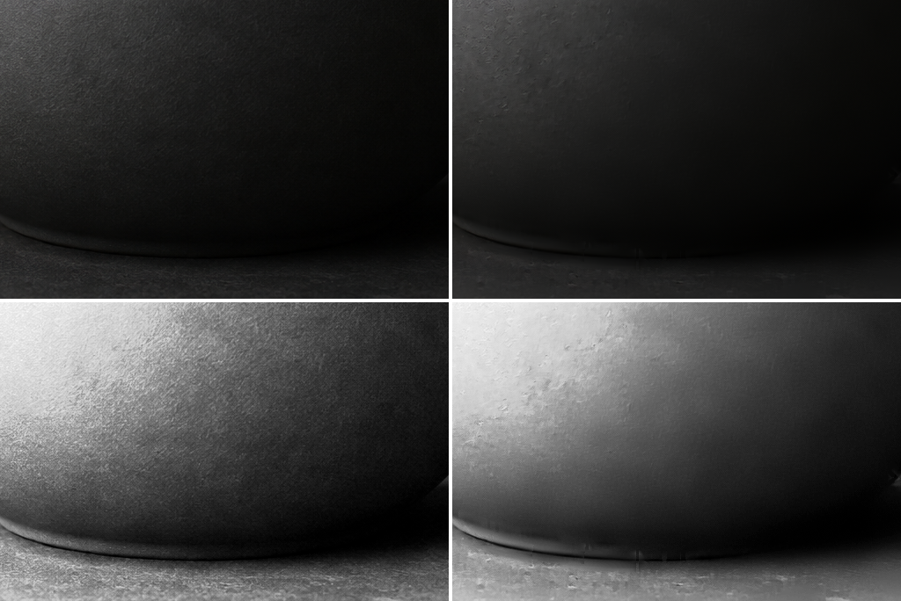
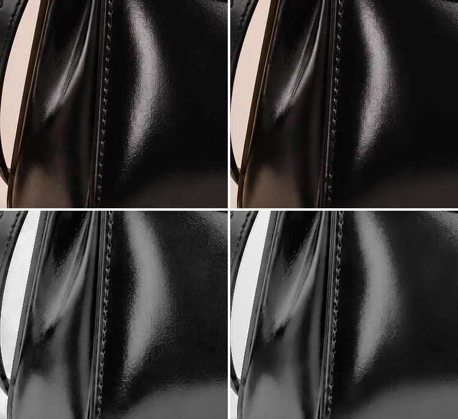

# GPT Image Restore

[한국어](README_ko.md)


### **[Web version](https://gpt-image-restore.hehee9.chatgpt.site)**

### **[Before/after comparison](https://hehee9.github.io/gpt-image-restore/)**

**Zoom in and compare the original with the** `balanced` **and** `strong` **results.**


---

## Overview

Reduces generation noise in GPT Image output, such as diagonal crosshatching, fine periodic patterns, bright dots, and blotches on flat backgrounds. It restores the image while keeping outlines and text strokes intact.

### Examples

The original is on the left and the `strong` result is on the right, and the black-and-white images apply a contrast boost so the noise is easier to see. The examples were generated with GPT Image 2.6.

  
  


---

## Desktop app

Download the archive for your operating system from [Releases](https://github.com/hehee9/gpt-image-restore/releases), extract it, and run `gpt-image-restore-gui` on Windows and Linux or `GPT Image Restore.app` on macOS. You can add multiple images, compare them before and after, and adjust the preset and per-stage strengths.

The macOS app is unsigned, so on first launch you need to click `Open Anyway` in `System Settings > Privacy & Security`. On Linux, GTK 3 and WebKit2GTK are required.

Runs on 64-bit Windows 10 or later, macOS, or Linux. Images generated in ChatGPT and Codex are **about 1.6 MP**.

| Image size       | Minimum  | Recommended                     |
| ---------------- | -------- | ------------------------------- |
| **About 1.6 MP** | 4 GB RAM | 8 GB RAM                        |
| 16 MP            | 8 GB RAM | 4-core or better CPU, 16 GB RAM |

---

## Web version

You can restore images right away in the [Web version](https://gpt-image-restore.hehee9.chatgpt.site) without installing anything. Images are processed only in your browser, and images up to 16,777,216 pixels (4096x4096) in total are supported.

---

## Python

Requires Python 3.10 or later.

```powershell
git clone https://github.com/hehee9/gpt-image-restore.git
cd gpt-image-restore
python -m pip install -r requirements.txt
```

To use an NVIDIA GPU, also install CuPy and the CUDA 12 packages with `python -m pip install ".[gpu]"`. If you have a C compiler, run `python -m pip install cython` and then build the Cython extensions with `python setup.py build_ext --inplace` for faster processing; the results are the same.

### Commands

Restore a single image. The result is saved as `input_restored.png` in a `restored` folder next to the input file.

```powershell
python restore_gpt_image.py "input.png"
```

When you pass a folder, PNG, JPG, and WebP images in its subfolders are restored as well.

```powershell
python restore_gpt_image.py "images" -o "results" --preset strong
```

### Presets

| Preset | Use |
|---|---|
| `safe` | Leaves bright dots untouched and lightly corrects crosshatch and blotches |
| `balanced` | Default preset for general restoration |
| `strong` | Also corrects sparkle, fine grid, edge ripple, blurred background, and cel fill |

Setting a per-stage strength such as `--dots 0` or `--grime 0.5` changes only that value in the preset, and `0` turns the stage off. Stronger settings can also fade small real highlights such as starlight or metallic reflections, or texture patterns that resemble crosshatching, so compare the results while adjusting.

### Main options

| Option | Description | Default |
|---|---|---|
| `-o` | Folder for restored results | `restored` next to the input |
| `--preset` | `safe`, `balanced`, `strong` | `balanced` |
| `--device` | Device: `cpu`, `gpu` | `cpu` |
| `--format` | Output format: `png`, `jpg`, `webp` | `png` |
| `--bit-depth` | PNG bit depth: `8`, `16` | `8` |
| `--report` | Save a JSON report per image | Off |
| `--save-diff` | Save a before/after difference image | Off |

Run `python restore_gpt_image.py -h` to see all options.

---

## License

Distributed under [AGPL-3.0-or-later](LICENSE). Copyright 2026 hehee9.

---

> Contact: gyugyum@gmail.com
