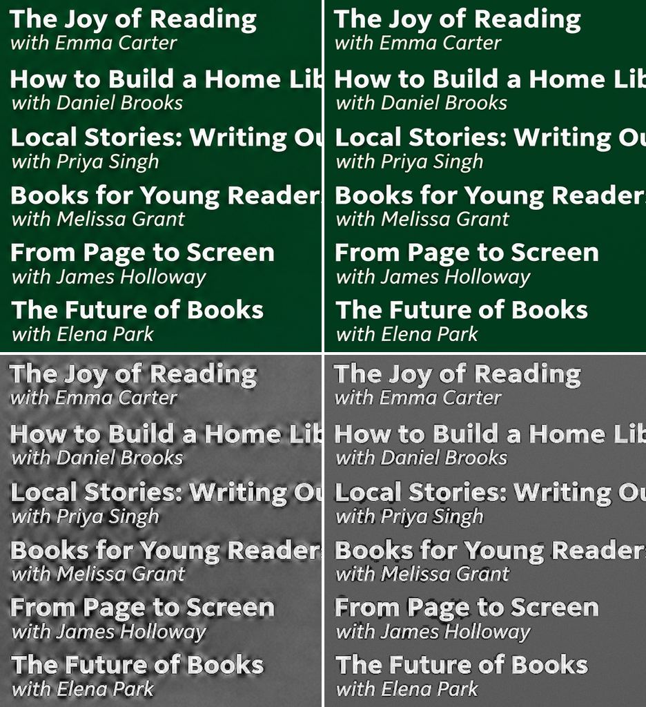
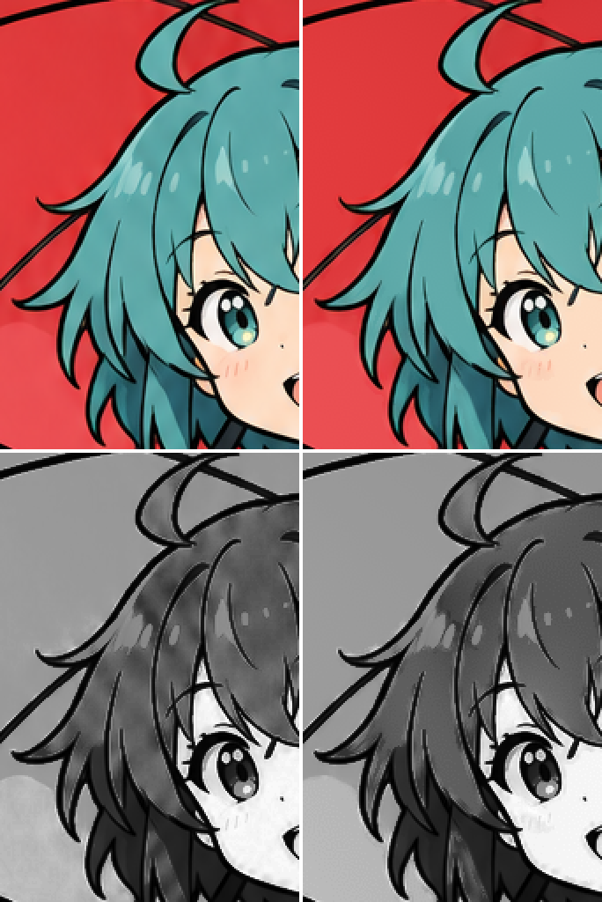
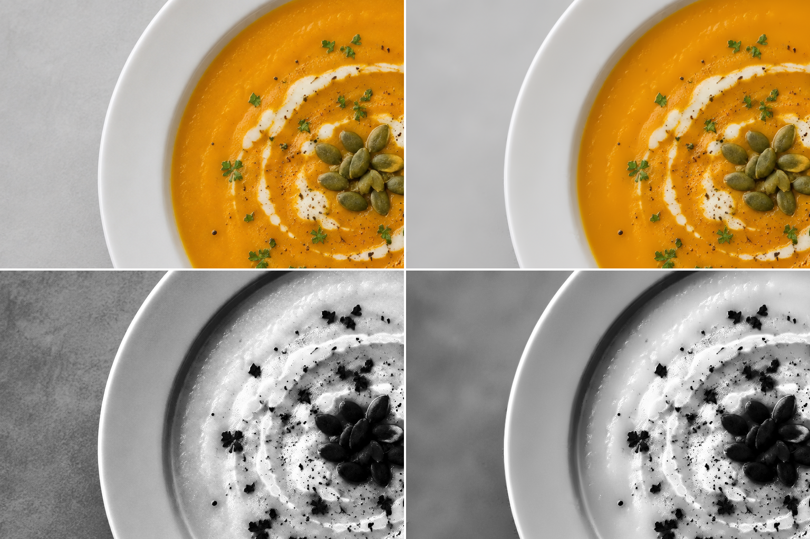

# GPT Image Restore

[English](README.md)


### **[전후 비교 페이지](https://hehee9.github.io/gpt-image-restore/)**

**위 링크에서 원본과** `balanced`**,** `strong` **보정 결과를 확대해 비교할 수 있습니다.**


---

## 개요

GPT Image 결과물에 나타나는 대각선 노이즈, 미세한 주기 패턴, 점묘 현상, 평탄한 배경의 얼룩 같은 생성 노이즈를 감소시킵니다. 윤곽선과 글자 획은 유지하면서 노이즈를 보정합니다.

### 보정 예시

왼쪽은 원본, 오른쪽은 `strong` 보정 결과이며, 흑백 이미지는 노이즈가 잘 보이도록 대비 강조를 적용한 것입니다. 예시는 GPT Image 2.6으로 생성한 이미지입니다.

  
  


---

## 데스크톱 앱

[Releases](https://github.com/hehee9/gpt-image-restore/releases)에서 운영체제에 맞는 압축 파일을 받아 압축을 해제한 뒤, Windows와 Linux에서는 `gpt-image-restore-gui`를, macOS에서는 `GPT Image Restore.app`을 실행합니다. 여러 이미지를 넣고 보정 전후를 비교하며 프리셋과 단계별 강도를 조절할 수 있습니다.

macOS 앱은 서명되지 않아 처음 실행할 때 `시스템 설정 > 개인정보 보호 및 보안`에서 `그래도 열기`를 클릭해야 합니다. Linux에서는 GTK 3와 WebKit2GTK가 필요합니다.

64비트 Windows 10 이상, macOS 또는 Linux에서 실행됩니다. ChatGPT와 Codex에서 생성한 이미지가 **약 1.6MP**입니다.

| 이미지 크기      | 최소 사양   | 권장 사양                |
| ----------- | ------- | -------------------- |
| **약 1.6MP** | RAM 4GB | RAM 8GB              |
| 16MP        | RAM 8GB | 4코어 이상 CPU, RAM 16GB |

---

## 웹 버전

설치 없이 [웹 버전](https://gpt-image-restore.hehee9.chatgpt.site)에서 바로 보정할 수 있습니다. 이미지는 브라우저 안에서만 처리되며, 총 16,777,216픽셀(4096x4096) 이하만 지원합니다.

---

## Python

Python 3.10 이상이 필요합니다.

```powershell
git clone https://github.com/hehee9/gpt-image-restore.git
cd gpt-image-restore
python -m pip install -r requirements.txt
```

NVIDIA GPU를 사용하려면 `python -m pip install ".[gpu]"`로 CuPy와 CUDA 12 관련 패키지를 추가로 설치합니다. C 컴파일러가 있으면 `python -m pip install cython`을 실행한 뒤 `python setup.py build_ext --inplace`로 Cython 확장을 빌드해 처리 속도를 높일 수 있으며, 보정 결과는 같습니다.

### 명령어

이미지 한 장을 보정합니다. 결과는 입력 파일 위치의 `restored` 폴더에 `input_restored.png`로 저장됩니다.

```powershell
python restore_gpt_image.py "input.png"
```

폴더를 지정하면 하위 폴더의 PNG, JPG, WebP 이미지까지 한 번에 보정합니다.

```powershell
python restore_gpt_image.py "images" -o "results" --preset strong
```

### 프리셋

| 프리셋 | 용도 |
|---|---|
| `safe` | 점묘 현상은 유지하고 대각선 노이즈와 얼룩만 약하게 보정 |
| `balanced` | 기본 프리셋, 일반적인 보정 |
| `strong` | 반짝임, 미세 격자, 윤곽 물결, 흐린 배경, 셀 채색까지 보정 |

`--dots 0`, `--grime 0.5`처럼 단계별 강도를 지정하면 프리셋의 해당 값만 바뀌며, `0`으로 설정하면 그 단계가 꺼집니다. 보정 강도를 높이면 실제 별빛이나 금속 반사 같은 작은 하이라이트나 해칭과 비슷한 질감 무늬까지 옅어질 수 있으므로 결과를 비교하며 조절하는 것이 좋습니다.

### 주요 옵션

| 옵션 | 설명 | 기본값 |
|---|---|---|
| `-o` | 보정 결과를 저장할 폴더 | 입력 파일 위치의 `restored` |
| `--preset` | `safe`, `balanced`, `strong` | `balanced` |
| `--device` | 실행 장치: `cpu`, `gpu` | `cpu` |
| `--format` | 출력 형식: `png`, `jpg`, `webp` | `png` |
| `--bit-depth` | PNG 비트 깊이: `8`, `16` | `8` |
| `--report` | 이미지별 JSON 보고서 저장 | 꺼짐 |
| `--save-diff` | 보정 전후 차이 이미지 저장 | 꺼짐 |

전체 옵션은 `python restore_gpt_image.py -h`로 확인할 수 있습니다.

---

## 라이선스

[AGPL-3.0-or-later](LICENSE)에 따라 배포됩니다. Copyright 2026 hehee9.

---

> 연락처: gyugyum@gmail.com
